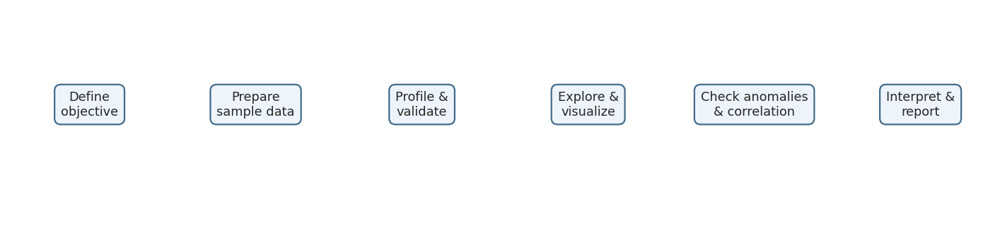
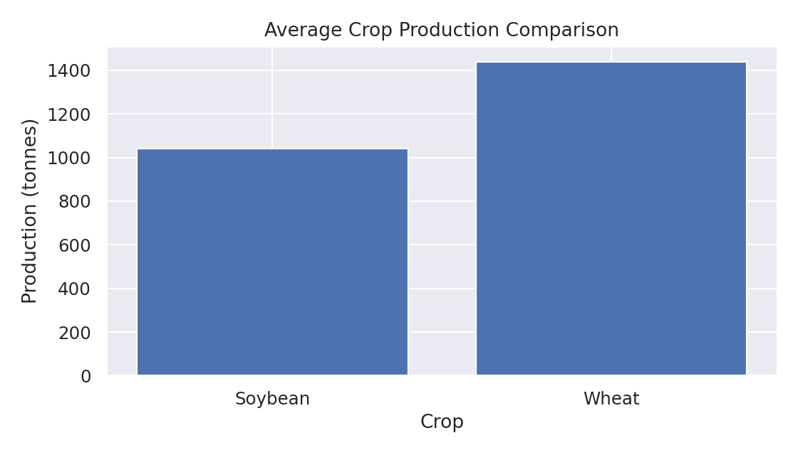
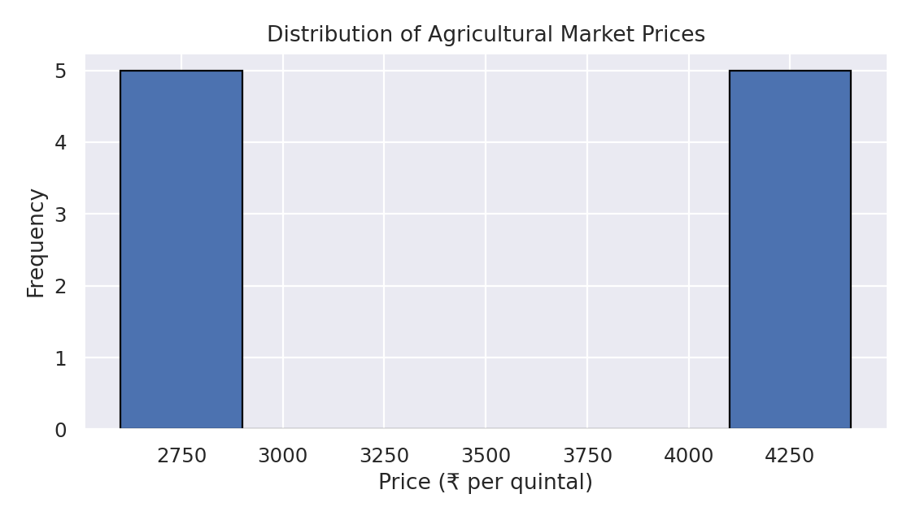
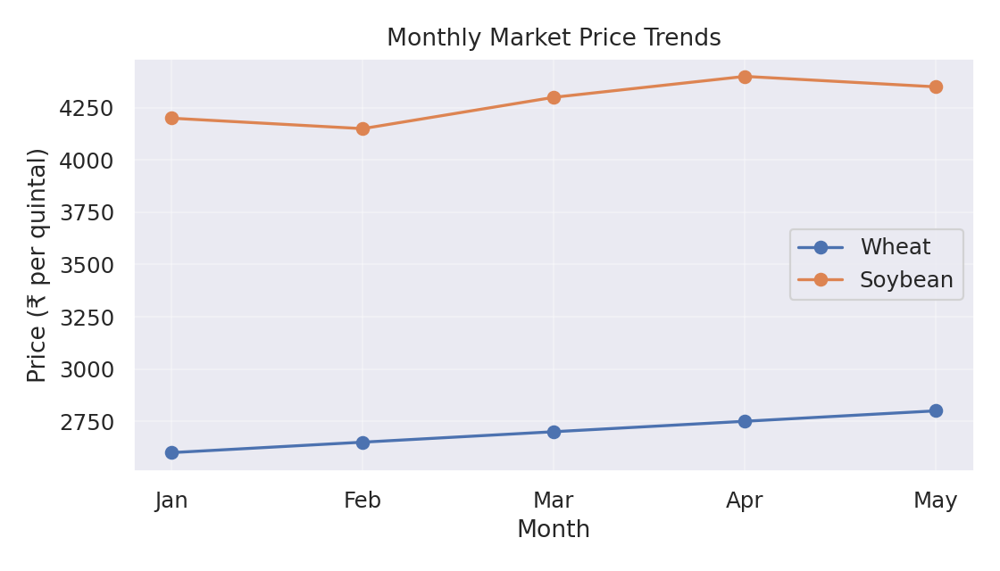
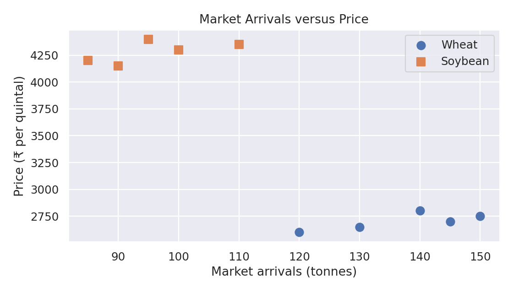
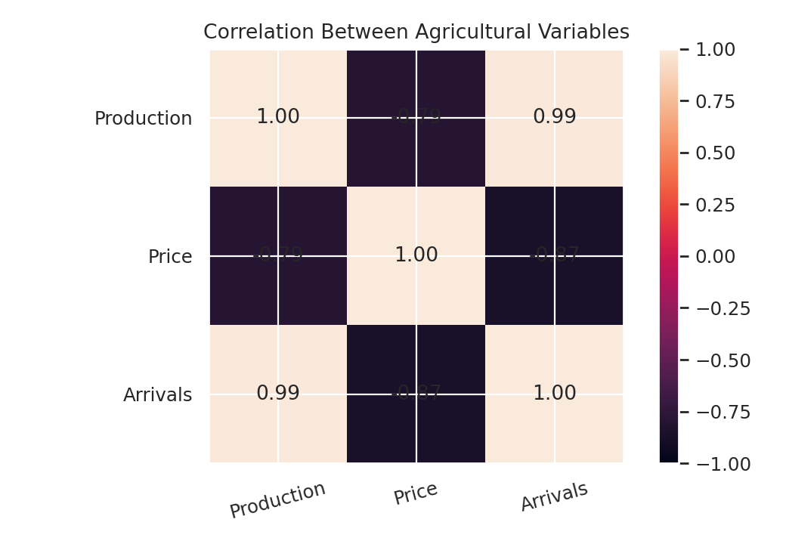
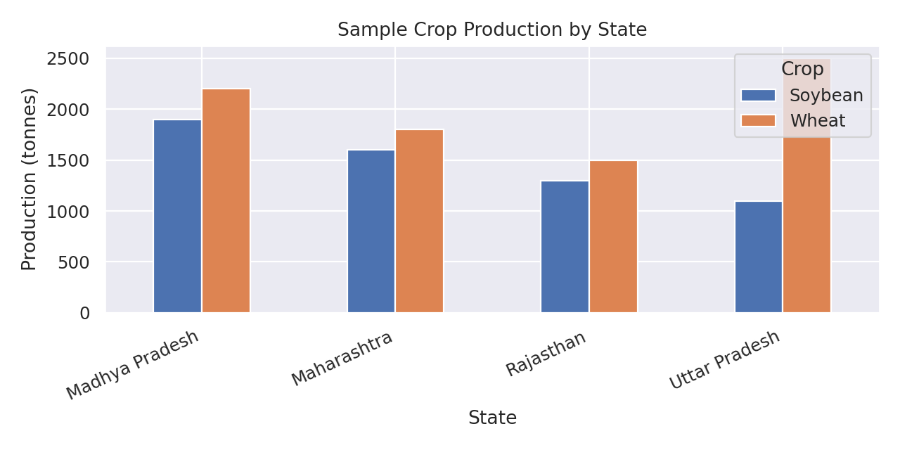
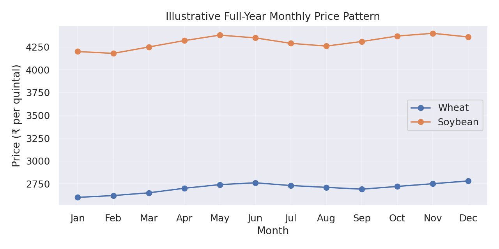

# Week 3 – Exploratory Data Analysis (EDA)

## Project: Agribusiness Data Analysis – Wheat and Soybean in India

### 1. Overview

During Week 3 of my Junior Data Scientist Internship at YuvaIntern, I performed Exploratory Data Analysis (EDA) for an agribusiness data analysis project focused on wheat and soybean in India.

The objective was to understand the dataset, calculate descriptive statistics, explore relationships between variables, identify potential outliers, and communicate observations through visualizations using Python in Google Colab.

**Data note:** The datasets used in this practical demonstration contain fictional sample values created for learning. They are not official agricultural production, mandi price, or market-arrival observations.

### 2. Objectives

- Understand the structure and characteristics of agricultural datasets.
- Analyse crop production, market prices, and market arrivals.
- Compare wheat and soybean production.
- Explore monthly price movements.
- Examine relationships between agricultural variables.
- Identify potential outliers using a statistical method.
- Present findings using charts and visualizations.

### 3. Dataset Description

The main demonstration dataset contains 10 records and five variables.

| Variable | Description |
|---|---|
| Month | Month of observation |
| Crop | Wheat or Soybean |
| Production | Production quantity in tonnes |
| Price | Market price in ₹ per quintal |
| Arrivals | Market arrivals in tonnes |

Additional fictional datasets were created to demonstrate state-wise production comparison and a 12-month price trend.

### 4. Tools and Technologies

- Python
- Google Colab
- Pandas
- NumPy
- Matplotlib
- Seaborn

### 5. EDA Workflow



### 6. Initial Data Exploration

Initial exploration was performed using Pandas. The checks included dataset dimensions, column names, data types, missing values, and descriptive statistics.

| Check | Result |
|---|---:|
| Total records | 10 |
| Total columns | 5 |
| Missing values | 0 |
| Average production | 1,240 tonnes |
| Average price | ₹3,490 per quintal |
| Average arrivals | 116.5 tonnes |

### 7. Data Visualizations

#### 7.1 Bar Chart – Crop Production Comparison



The bar chart compares average production of the two crops.

- Wheat average production: **1,440 tonnes**
- Soybean average production: **1,040 tonnes**

In this fictional sample, wheat has a higher average production than soybean.

#### 7.2 Histogram – Market Price Distribution



The histogram shows the frequency distribution of sample market prices. The values form two visible groups: wheat prices around ₹2,600–₹2,800 and soybean prices around ₹4,150–₹4,400.

#### 7.3 Line Chart – Monthly Price Trends



The line chart compares monthly prices from January to May.

- Wheat prices rise from ₹2,600 in January to ₹2,800 in May.
- Soybean prices fall slightly in February, rise to ₹4,400 in April, and decrease to ₹4,350 in May.

#### 7.4 Scatter Plot – Market Arrivals vs Price



The scatter plot examines the relationship between market arrivals and prices. Each point represents one crop-month observation. The small sample is not sufficient to establish a reliable relationship or causation.

#### 7.5 Heatmap – Correlation Analysis



The heatmap displays correlations between numerical variables.

| Variable Pair | Correlation |
|---|---:|
| Production and Price | -0.79 |
| Production and Arrivals | +0.99 |
| Price and Arrivals | -0.87 |

These correlations are calculated across both crop groups in the fictional sample. Differences between wheat and soybean may influence the combined results. Correlation does not establish causation.

### 8. Regional Production Analysis

A separate fictional dataset was prepared to demonstrate state-wise production comparison for wheat and soybean.



The demonstration includes Maharashtra, Madhya Pradesh, Rajasthan, and Uttar Pradesh. The grouped bar chart shows how production values can be compared by state and crop.

**Note:** These values are illustrative only and must not be treated as actual state production statistics.

### 9. Seasonal Trend Analysis

A separate fictional 12-month dataset was created to demonstrate a full-year monthly price trend.



The line chart demonstrates how monthly prices for wheat and soybean can be compared across January to December.

A real seasonal analysis should use verified monthly observations over several years to identify recurring patterns.

### 10. Statistical Anomaly Detection

The Interquartile Range (IQR) method was applied to the sample Price column.

| Metric | Result |
|---|---:|
| Q1 | ₹2,712.50 |
| Q3 | ₹4,275.00 |
| IQR | ₹1,562.50 |
| Lower limit | ₹368.75 |
| Upper limit | ₹6,618.75 |
| Potential outliers detected | 0 |

No sample price fell outside the calculated IQR limits. This does not prove every record is correct. Unusual values in real data should be checked against the original source, unit, date, market, and crop.

### 11. Key Learnings

- Performed exploratory data analysis using Python and Pandas.
- Calculated descriptive statistics.
- Created bar charts, histograms, line charts, scatter plots, and heatmaps.
- Interpreted correlation values.
- Applied the IQR method for potential outlier detection.
- Explored regional and seasonal visualization approaches.
- Understood the importance of data validation and cautious interpretation.

### 12. Limitations

- The practical datasets contain fictional sample values.
- The main dataset contains only 10 records.
- The original dataset covers January to May only.
- The regional and 12-month datasets are separate demonstrations, not official data.
- The sample is not sufficient for reliable real-world agricultural conclusions.
- Combined correlations across two crops may be affected by differences between crop groups.

### 13. Conclusion

This task provided practical experience in exploratory data analysis, statistical summaries, visualization, correlation analysis, and anomaly detection. Five core visualizations were created using Python, and supplementary datasets were used to demonstrate regional production comparison and a full-year seasonal trend.

The exercise improved my understanding of how EDA can support further agricultural data analysis. A real-world study would require verified production, market price, and arrival records with consistent dates, units, and geographic details.

### 14. Project Files

```text
week-3-eda/
├── Week_3_Exploratory_Data_Analysis_Updated.ipynb
├── week3_agriculture_sample.csv
├── week3_regional_sample.csv
├── week3_seasonal_sample.csv
├── WEEK_3_REPORT.md
├── week3_eda_workflow.png
├── week3_bar_chart.png
├── week3_histogram.png
├── week3_line_chart.png
├── week3_scatter_plot.png
├── week3_heatmap.png
├── week3_regional_production.png
└── week3_seasonal_trend.png
```

### 15. Learning Resources

- [Pandas Documentation](https://pandas.pydata.org/docs/)
- [Matplotlib Documentation](https://matplotlib.org/stable/)
- [Seaborn Documentation](https://seaborn.pydata.org/)
- [Google Colab](https://colab.research.google.com/)

**Internship:** Junior Data Scientist – YuvaIntern  
**Task:** Week 3 – Exploratory Data Analysis (EDA)
